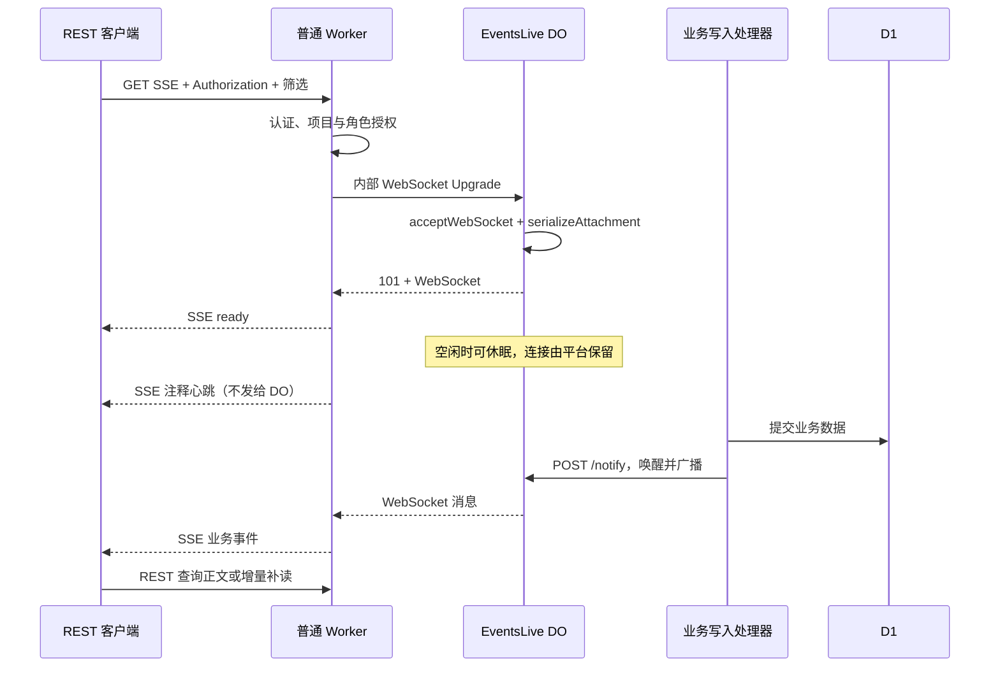

# REST SSE 事件与 Durable Object 休眠实现指南

本文供 co-ai 实现 REST 主动连接事件使用，参考 english_word_learn 已实现并经过真实 Worker/DO 测试的方案（提交 `b5d9548`、`e16486c`，2026-10-23）。下文保留架构指南与示意；co-ai 已按此方案实现，正式接口合约见 [REST SSE 事件](../llm/API.md#rest-sse-事件) 和 [OpenAPI](../llm/openapi.json)。实现采用 `/api/v1/events`、`/api/v1/events/stream`，每用户每项目 16 条、项目共 256 条连接，15 秒心跳、55 秒流寿命；与现有 MCP webhook 一样排除发送角色自身。`tests/rest-events.test.ts` 使用真实 workerd 空闲驱逐验证实例替换、attachment 保留、旧连接推送及驱逐后限额，无需额外 cloudflare:test 测试环境。

## 1. 架构：外部 SSE，内部 Hibernation WebSocket

REST 客户端主动发起 GET，在同一个 HTTP 响应上读取事件；MCP Events 继续通过 webhook 回调。两种传输可以共享业务事件定义，但订阅、重试与生命周期分别处理。



**不要直接在 DO 中保持 SSE 响应。** DO 的 Hibernation API 用于它接受的 WebSocket；直接持有 SSE、周期定时器或未结束的工作会阻止休眠。普通 Worker 负责 SSE 流、心跳、超时与背压；DO 只负责接受内部连接、保存筛选 attachment、按事件唤醒广播。

DO 必须调用 `state.acceptWebSocket(server)`，不能用普通的 `server.accept()`。普通 Worker 对内部连接的客户端一侧调用 `socket.accept()` 是正确的。DO 主动向外建立的 WebSocket 不适用这个休眠方案。

空闲且满足休眠条件时，DO 不计时长费，实际何时休眠由平台决定；连接建立、事件处理及请求仍会计费。普通 Worker 不按请求持续时长收费，但请求和 CPU 仍计费。短周期重连也会唤醒 DO，需在撤权时效和连接成本之间选取参数。

## 2. co-ai 的接入位置

| 当前实现 | REST SSE 接入建议 |
| --- | --- |
| [src/mcp-events.ts](../src/mcp-events.ts) 的 `messageEvent` | 抽取传输无关的事件名、筛选 schema、payload schema；MCP 继续声明 `delivery: ['webhook']`，REST 目录声明 `['sse']`。 |
| [src/index.ts](../src/index.ts) 的 `/api/v1/*` 认证中间件 | 复用 API Key、OAuth read scope 与会话认证策略；REST SSE 支持哪些凭证须明确写入 API 合约。 |
| [src/items.ts](../src/items.ts) 的消息写入路径 | 在业务成功提交后发出即时通知；覆盖实际创建消息的所有路径，先核对现有事件产生条件，避免更新操作意外变成新消息事件。 |
| `mcp_event_subscriptions` 与 `deliverMessageEvents` | 保留 webhook 聚合、签名、租约及投递重试；SSE 不依赖 webhook 订阅行或每分钟 Cron。 |
| [wrangler.jsonc](../wrangler.jsonc)、[src/types.ts](../src/types.ts)、入口导出 | 增加 DO 绑定、类型与类导出，以及新的 DO migration。 |
| [llm/API.md](../llm/API.md)、[llm/openapi.json](../llm/openapi.json) | 真正实现时同步公开 API、错误、认证与恢复约定；`public/llm/` 由构建生成。 |

现有 `role.messages.received` 的 webhook 描述约定五分钟聚合一次。SSE 若逐条即时推送，应明确记录传输差异，不能直接复用带有“五分钟”描述的目录。可沿用现有 payload schema：单条 SSE 令 `message_count = 1`，首尾消息 ID 与时间分别相同；webhook 保留聚合行为。若产品需要统一节流或不同 payload，应先定义合约再实现。

### 权限与对象划分

连接参数建议为 `name`、`project_id`、`recipient_role_id`，按严格 schema 校验 UUID、未知字段和重复参数。服务端应验证项目访问权、项目 Key 限制、项目归档状态及接收角色是否属于该项目且有效。角色仅是消息筛选条件，不授予项目访问权。

一个可行的 DO 分区是“已授权项目一个对象”，通过服务端校验后的项目 ID 生成 `idFromName()`，每条 socket 的 attachment 保存认证主体标识和角色筛选；禁止客户端直接调用 DO 或通过自报身份取得权限。也可以按认证主体分区，但业务发布方必须明确如何枚举接收主体，不能因此漏发或跨用户广播。

项目分区广播时：定向消息匹配其接收角色；包含 `ALL` 的广播消息匹配所有已授权角色连接。一条消息同时包含 `ALL` 和具体角色时，每条连接只发送一次。不要把发送者 `role_id` 当成接收者筛选。

Key 撤销、OAuth grant 撤销、用户禁用、项目权限变化及角色归档都需要定义对现存连接的影响。建议每条流最多 55 秒，重连重新授权；这个方案有最长约 55 秒的通知权限窗口。若要求立即停发，需增加撤权主动关闭或发布时重新授权，不能仅依赖初次建连检查。正文读取始终重新校验权限。

## 3. DO 最小结构

下面是机制示意，省略了 co-ai 的内部输入校验、错误格式、连接限额和授权检查，不能直接当完整实现部署。`/events` 和 `/notify` 只经内部 DO binding 访问。

```ts
type Filter = { principalId: string; recipientRoleId: string };
type Notice = {
  event: { eventId: string; name: string; timestamp: string; data: unknown };
  recipientRoleIds: string[];
};

export class EventsLive {
  constructor(private readonly state: DurableObjectState) {}

  async fetch(request: Request): Promise<Response> {
    const url = new URL(request.url);
    if (url.pathname === '/notify' && request.method === 'POST') {
      const notice = await request.json() as Notice;
      const frame = `id: ${notice.event.eventId}\nevent: ${notice.event.name}\ndata: ${JSON.stringify(notice.event)}\n\n`;
      for (const socket of this.state.getWebSockets()) {
        const filter = socket.deserializeAttachment() as Filter;
        if (socket.readyState !== WebSocket.OPEN) continue;
        if (!notice.recipientRoleIds.includes('ALL') &&
            !notice.recipientRoleIds.includes(filter.recipientRoleId)) continue;
        try { socket.send(frame); } catch { this.webSocketError(socket); }
      }
      return new Response(null, { status: 204 });
    }
    if (url.pathname !== '/events' || request.method !== 'GET') {
      return new Response(null, { status: 404 });
    }
    if (request.headers.get('Upgrade')?.toLowerCase() !== 'websocket') {
      return new Response(null, { status: 426 });
    }
    // 此处先检查全对象及各主体的 OPEN socket 数量，再接受连接。
    const pair = new WebSocketPair();
    this.state.acceptWebSocket(pair[1]);
    pair[1].serializeAttachment({
      principalId: url.searchParams.get('principal_id')!,
      recipientRoleId: url.searchParams.get('recipient_role_id')!,
    } satisfies Filter);
    return new Response(null, { status: 101, webSocket: pair[0] });
  }

  webSocketMessage(socket: WebSocket) {
    socket.close(1008, 'Receive-only connection');
  }
  webSocketClose(socket: WebSocket, code: number, reason: string) {
    socket.close(code === 1005 || code === 1006 ? 1000 : code, reason);
  }
  webSocketError(socket: WebSocket) {
    try { socket.close(1011, 'Connection failed'); } catch {}
  }
}
```

项目分区已限定 project，示例只展示一种事件；扩展多事件时 attachment 必须包含事件筛选，并在广播时匹配。实际代码还应限制 payload 大小，校验内部消息字段；事件 ID 和名称必须来自服务端生成的安全值，不能包含换行造成 SSE 字段注入。

不要依赖实例内 `Map`、计数器或订阅数组：DO 唤醒会重新运行构造函数。每次从 `state.getWebSockets()` 恢复连接，从 `deserializeAttachment()` 恢复筛选，限额也统计平台保留的 OPEN sockets。attachment 仅保存小型可序列化筛选与主体标识，不保存 Bearer token。

## 4. 普通 Worker 的 SSE 桥接

1. 完成认证和授权后，使用 DO stub 发起带 `Upgrade: websocket` 的内部 GET，筛选和主体标识由服务端填写。DO 返回 429 等错误时，在 SSE 建立前返回对应错误；成功时要求 `status === 101` 且有 `response.webSocket`。
2. 创建 `ReadableStream<Uint8Array>`；先安装内部 socket 的 `message`、`close`、`error` 处理器，再调用客户端一侧的 `socket.accept()`。把 DO 发来的完整 SSE 字符串编码后 enqueue。
3. 在连接被 DO 接受后，先发送 `retry: 1000\nevent: ready\ndata: {}\n\n`；ready 表示订阅已生效，便于客户端开始补读。
4. 每 15 秒直接向 SSE 写入注释 `: heartbeat\n\n`。这个定时器属于普通 Worker，**不要把心跳转发给 DO**。
5. 55 秒后关闭流及内部 socket，促使客户端重新认证。定时器必须放在普通 Worker，DO 内不设周期定时器或连接到期定时器。
6. 建议按字节设置 64 KiB 队列：`{ highWaterMark: 64 * 1024, size: chunk => chunk.byteLength }`。enqueue 前检查 `desiredSize`，不足时断开慢消费者，禁止无界缓存。
7. 请求 abort、流 cancel、WebSocket error/close、超时、背压或 enqueue 异常统一进入幂等清理函数：清理定时器和监听、关闭流、关闭内部 socket。cancel 可短暂等待 close 握手（参考实现上限 2 秒），以便快速重连时释放 DO 连接名额。

响应使用 `Content-Type: text/event-stream`、`Cache-Control: no-store, no-transform`、`X-Content-Type-Options: nosniff`。检查外层 Hono 中间件不缓存、聚合或改写流。参考应用的桥接完整代码见下方源码索引，比仅调用 `streamSSE()` 多了内部 socket 生命周期与背压管理。

建议每主体最多 16 条连接，并另设项目对象总限额；项目共享一个 DO 时不能把“每用户 16 条”误实现成“整个项目 16 条”。超限返回 429 和 `Retry-After: 30`。这些值是应用参数，不是 Cloudflare 平台固定限制。

## 5. 协议、发布与恢复

建议新增事件目录和流接口，例如：

```text
GET /api/v1/events
GET /api/v1/events/stream?name=role.messages.received&project_id=<uuid>&recipient_role_id=<uuid>
Authorization: Bearer <API_KEY_OR_SUPPORTED_OAUTH_TOKEN>
Accept: text/event-stream
```

Key 不进入 URL。浏览器使用支持 Authorization 头的 `fetch()` 流式读取；原生 `EventSource` 不能设置该头。Cookie、Origin 与跨域策略沿用 co-ai 明确定义的认证边界，不照搬参考应用“仅个人 Key”的限制；若启用跨域，须明确允许来源、预检和凭证策略。

业务帧示例（尖括号字段为占位符）：

```text
id: evt_message_<message_uuid>_<recipient_role_uuid>
event: role.messages.received
data: {"eventId":"evt_message_<message_uuid>_<recipient_role_uuid>","name":"role.messages.received","timestamp":"2026-10-23T00:00:00.000Z","data":{"project_id":"<project_uuid>","recipient_role_id":"<recipient_role_uuid>","message_count":1,"first_message_id":"<message_uuid>","last_message_id":"<message_uuid>","first_received_at":"2026-10-23T00:00:00.000Z","last_received_at":"2026-10-23T00:00:00.000Z"}}

```

DO 需按连接的接收角色构造上述 payload；对于 `ALL` 广播，`recipient_role_id` 仍是该连接订阅的角色。不要直接将这个单角色示例 payload 不加改写地广播给所有角色。参考第 3 节的通用广播骨架未包含这段业务 payload 构造逻辑。

事件是读取提示，不带消息正文、附件或密钥。事件 ID 在相同业务通知重试时稳定，用于去重；不保证不同传输的聚合事件与单条事件有相同 ID。DO 通知应在数据库提交成功后触发，设短超时（参考实现 2 秒），失败只记脱敏日志，不能把已成功写入改报失败或回滚。若用 `waitUntil()`，仍需捕获失败；通知不是持久化投递保证。

此方案不提供历史事件、ACK、离线队列或 exactly-once。建议拒绝 `Last-Event-ID` 并解释不支持重放，不能把事件 ID 伪装成可靠游标。需要可靠投递时另行设计持久化事件日志/outbox，不能仅添加该头部。

客户端每次初连和重连都执行：

1. 建流并等待 ready。
2. 同时消费实时通知，并用既有 REST 查询读取待处理数据或变化区间的全部分页。
3. 按消息 ID/version 合并流提示与查询结果，处理操作保持幂等。
4. 完成整轮增量查询后保存服务端 `sync_until`；中断时保留旧检查点，重做这一轮，避免跳页漏项。

co-ai 已有 `updated_since`、`include_deleted=true`、`sync_until` 的增量读取约定，优先复用并与角色筛选结合；补读不要使用截断范围的 `max_items`。没有可靠检查点的首次连接应读完整初始范围。**不能先查询再建流**，否则查询与订阅间有漏事件窗口；查询期间也不能暂停消费流。即使连接未断，通知也可能失败，55 秒重连后的补读或额外周期补读负责最终发现这类消息；不能只在收到事件时才查询。

客户端正常断流或网络失败后按 1–30 秒指数退避重连，成功后重置；401 停止并更新凭证，429 遵守 Retry-After，403/参数错误应先修正权限或参数。流式解析须支持 UTF-8 跨块、跨块帧和多行 `data:`，不能假定一次 `reader.read()` 就是一条事件。业务事件内容视为不可信数据。

## 6. 部署与验证

在现有 `wrangler.jsonc` 中合并绑定和新的 migration；保留既有配置和历史 migration，不修改旧 tag：

```jsonc
"durable_objects": {
  "bindings": [{ "name": "EVENTS_LIVE", "class_name": "EventsLive" }]
},
"migrations": [
  { "tag": "v1-events-live", "new_sqlite_classes": ["EventsLive"] }
]
```

示例 tag 仅适用于尚无 DO migration 的情况，实现时重新检查仓库状态。入口导出 `EventsLive`，Env 增加 `EVENTS_LIVE: DurableObjectNamespace`；测试环境同步绑定及 migration。这个方案无需新增 D1 事件表，已有消息数据承担补读来源。部署或运行时断开现有连接时，客户端通过重连和补读恢复。

实现后按仓库要求运行 `npm run typecheck`、`npm test`、`npm run build`，并至少覆盖：

- 真实 workerd/DO：ready 后发出业务事件、筛选正确、多连接广播、项目/Key/OAuth 权限隔离，以及 `ALL` 不重复发送。
- 写失败不发通知；写成功但 DO 通知失败仍返回业务成功，REST 查询可补读。
- 强制休眠驱逐：使用 `cloudflare:test` 的 `runInDurableObject` 给实例加临时标记，读取 sockets 的 attachment，然后 `evictDurableObject(stub)`；唤醒后标记消失而 attachment 保留，旧连接仍可收到事件。限额在驱逐后仍有效。
- 普通 Worker：假定时器验证 15 秒心跳、55 秒结束、abort/cancel/错误清理、慢消费者断开；确认心跳不会调用 DO，也没有残留定时器。
- 连接上限、关闭后立即重连、429/Retry-After、Key/grant 撤销、账号禁用、项目或角色失效的现有流与新流行为。
- 客户端 ready 后查询、多分页期间收事件、重复事件与断流后的增量恢复。仅测试正常持续连接不足以证明无遗漏。

强制驱逐测试证明休眠后连接和筛选可恢复；实际账单或运行平台是否满足空闲计费条件仍以 Cloudflare 文档及生产观测为准，不能通过 unit test 推断整个链路零费用。

## 7. 参考源码与官方依据

参考项目使用用户隔离和 `name + author` 筛选，co-ai 应替换为自身项目/角色模型：

- [REST 路由、认证与内部 Upgrade](../../english_word_learn/src/app/routes/events.ts)
- [Hibernation DO、attachment 与广播](../../english_word_learn/src/infra/events_live.ts)
- [普通 Worker SSE 桥接完整实现](../../english_word_learn/src/infra/events_stream.ts)
- [真实 Worker/DO 与强制驱逐测试](../../english_word_learn/test/events.worker.test.ts)
- [桥接定时器及背压测试](../../english_word_learn/test/events_live.test.ts)
- [已实现的客户端 SSE 合约](../../english_word_learn/docs/events-api.md)

上述相对链接适用于两个仓库并排检出的工作区；单独克隆 co-ai 时可按开头提交定位参考源码。

官方资料：[Hibernation WebSocket](https://developers.cloudflare.com/durable-objects/best-practices/websockets/)、[DO 生命周期与休眠条件](https://developers.cloudflare.com/durable-objects/concepts/durable-object-lifecycle/)、[休眠服务端示例](https://developers.cloudflare.com/durable-objects/examples/websocket-hibernation-server/)、[Worker WebSocket API](https://developers.cloudflare.com/workers/runtime-apis/websockets/)、[Workers 与 DO 计费](https://developers.cloudflare.com/workers/platform/pricing/)。
